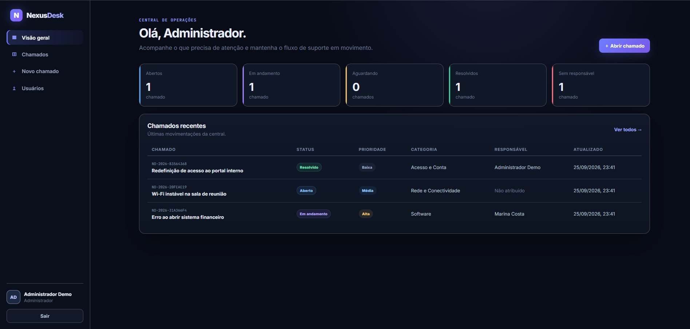
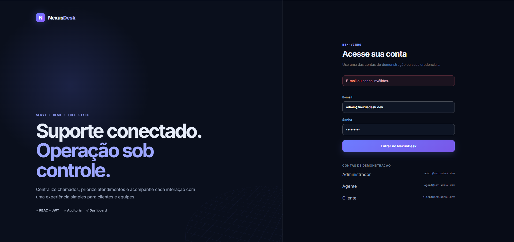
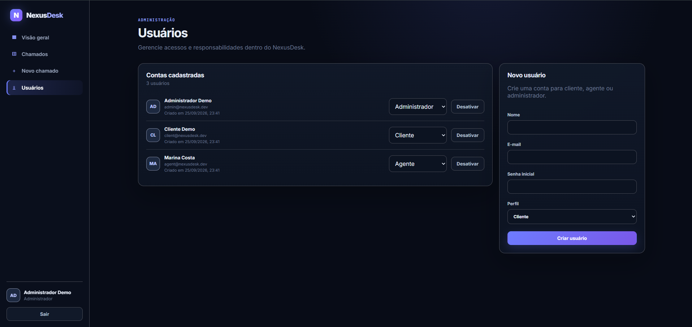
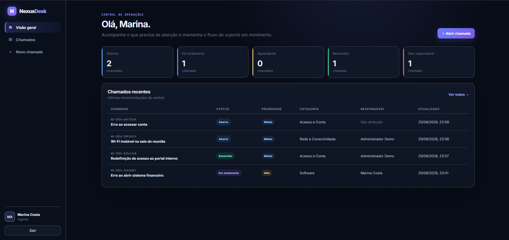
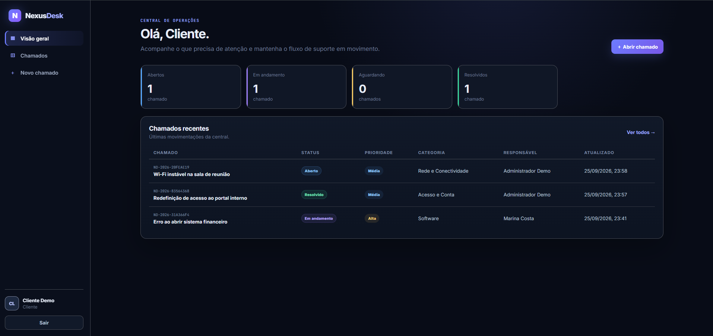

# NexusDesk

NexusDesk é uma aplicação full stack de Service Desk / Help Desk desenvolvida como projeto de portfólio.

O sistema permite criar e acompanhar chamados de suporte, gerenciar usuários e controlar diferentes níveis de acesso através dos perfis Cliente, Agente e Administrador.

O projeto foi desenvolvido utilizando Java com Spring Boot no backend, React com TypeScript no frontend e PostgreSQL como banco de dados.

## Principais recursos

- login com autenticação JWT;
- perfis de Cliente, Agente e Administrador;
- criação e acompanhamento de chamados;
- alteração de status e prioridade;
- atribuição de chamados para agentes;
- comentários e notas internas;
- dashboard com informações dos chamados;
- gerenciamento de usuários pelo administrador;
- filtros e busca de chamados;
- banco PostgreSQL;
- execução com Docker Compose.

## Stack

### Frontend
- React 19
- TypeScript
- React Router
- Vite
- CSS responsivo sem framework visual
- Nginx no container de produção

### Backend
- Java 21
- Spring Boot 4
- Spring Web MVC
- Spring Security
- OAuth2 Resource Server / JWT
- Spring Data JPA / Hibernate
- Bean Validation
- Flyway
- Actuator

### Dados e infraestrutura
- PostgreSQL 17
- Docker / Docker Compose
- GitHub Actions

## Arquitetura

```text
Browser
   |
   v
Nginx / React SPA  :8088
   |
   | /api
   v
Spring Boot API    :8080
   |
   v
PostgreSQL         :5432 (rede interna do Compose)
```

O frontend nunca decide sozinho se uma ação é permitida. As regras de autorização também são aplicadas na API. Um cliente, por exemplo, só consegue consultar os próprios chamados e não consegue criar ou visualizar notas internas.

Mais detalhes: [`docs/ARCHITECTURE.md`](docs/ARCHITECTURE.md).

## Screenshots

### Dashboard do Administrador



<details>
<summary>Ver mais telas</summary>

### Login



### Administração de usuários



### Dashboard do Agente



### Dashboard do Cliente



</details>

## Como executar — forma recomendada

### Pré-requisitos

Instale e abra o **Docker Desktop**. Não é necessário instalar Java, Maven, Node ou PostgreSQL separadamente quando você utiliza o Docker Compose.

### Windows

Na pasta do projeto, dê dois cliques em:

```text
start.bat
```

Ou execute no terminal:

```bash
docker compose up --build -d
```

Depois acesse:

```text
http://localhost:8088
```

### Linux/macOS

```bash
./start.sh
```

ou:

```bash
docker compose up --build -d
```

Acesse `http://localhost:8088`.

### Parar o sistema

Windows:

```text
stop.bat
```

Linux/macOS:

```bash
./stop.sh
```

Ou em qualquer sistema:

```bash
docker compose down
```

Para apagar também o volume do banco e recriar os dados de demonstração do zero:

```bash
docker compose down -v
```

## Contas de demonstração

| Perfil | E-mail | Senha |
|---|---|---|
| Administrador | `admin@nexusdesk.dev` | `Admin@123` |
| Agente | `agent@nexusdesk.dev` | `Agent@123` |
| Cliente | `client@nexusdesk.dev` | `Client@123` |

Na tela de login há atalhos que preenchem as credenciais de demonstração.

> As credenciais acima existem apenas para demonstração local. O seed só é ativado quando `SEED_DEMO=true` (o Docker Compose faz isso para facilitar os testes). Em um deploy público, mantenha `SEED_DEMO=false` e configure segredos próprios.

## O que testar

### Como Cliente

1. entre como `client@nexusdesk.dev`;
2. veja apenas os chamados pertencentes ao cliente;
3. abra um novo chamado;
4. adicione uma mensagem ao chamado;
5. confirme que controles administrativos e notas internas não aparecem.

### Como Agente

1. entre como `agent@nexusdesk.dev`;
2. abra um chamado sem responsável;
3. use **Assumir chamado**;
4. altere status, prioridade, categoria ou responsável;
5. adicione um comentário público;
6. adicione uma nota interna;
7. confira o histórico de auditoria.

### Como Administrador

1. entre como `admin@nexusdesk.dev`;
2. acesse **Usuários**;
3. crie um usuário;
4. altere papel ou estado ativo/inativo de outro usuário;
5. confirme as proteções contra desativar ou rebaixar a própria conta da sessão.

## Desenvolvimento sem Docker

### Backend

Pré-requisitos: Java 21, Maven e PostgreSQL.

Crie um banco chamado `nexusdesk`, ajuste as variáveis abaixo e execute:

```bash
cd backend
mvn spring-boot:run
```

Variáveis aceitas:

```text
DB_URL=jdbc:postgresql://localhost:5432/nexusdesk
DB_USER=nexusdesk
DB_PASSWORD=nexusdesk
JWT_SECRET=uma-chave-com-pelo-menos-32-bytes
JWT_TTL_MINUTES=480
SEED_DEMO=true
CORS_ALLOWED_ORIGINS=http://localhost:5173,http://localhost:8088
```

### Frontend

Pré-requisito: Node.js moderno.

```bash
cd frontend
npm install
npm run dev
```

Durante o desenvolvimento, o Vite encaminha `/api` para `http://localhost:8080`.

## Testes e verificação

Backend:

```bash
cd backend
mvn test
```

Frontend:

```bash
cd frontend
npm install
npm run typecheck
npm run build
```

Com Docker:

```bash
docker compose ps
docker compose logs -f api
```

Health endpoint:

```text
http://localhost:8088/actuator/health
```

A checklist da validação manual está em [`docs/VALIDATION.md`](docs/VALIDATION.md).


## API

O backend disponibiliza uma API REST utilizada pelo frontend.

Os principais endpoints estão documentados em [`docs/API.md`](docs/API.md).

## Estrutura do repositório

```text
NexusDesk/
├── .github/workflows/ci.yml
├── backend/
│   ├── src/main/java/com/nexusdesk/
│   │   ├── admin/
│   │   ├── auth/
│   │   ├── common/
│   │   ├── config/
│   │   ├── dashboard/
│   │   ├── security/
│   │   ├── ticket/
│   │   └── user/
│   ├── src/main/resources/db/migration/
│   ├── Dockerfile
│   └── pom.xml
├── frontend/
│   ├── src/
│   │   ├── components/
│   │   ├── context/
│   │   ├── lib/
│   │   └── pages/
│   ├── Dockerfile
│   ├── nginx.conf
│   └── package.json
├── docs/
├── docker-compose.yml
├── start.bat
└── README.md
```


## Versão e histórico

Consulte [`CHANGELOG.md`](CHANGELOG.md) para o histórico de versões do projeto.


## Licença

MIT. Consulte [`LICENSE`](LICENSE).
